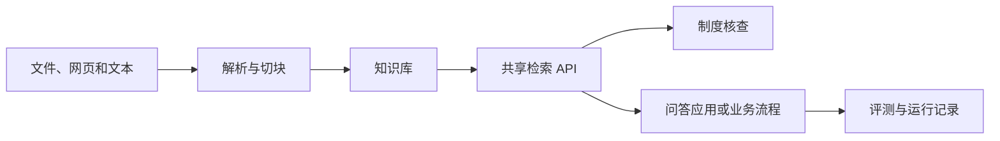

# Local RAG

面向 AI Work 的企业知识中台。把制度、操作手册和常见问题整理成可检索的知识库，供内部助手和业务流程复用。
https://mat11-oo.github.io/local-rag/

React · TypeScript · FastAPI · LangChain

[快速开始](#快速开始) · [它能做什么](#它能做什么) · [工作原理](#工作原理) · [API 接入](#api-接入) · [部署与权限](#部署与权限)

## 它能做什么

| 场景 | 能力 |
| --- | --- |
| 客服查制度 | 在知识库的「检索测试」中选择「查制度依据」，查看候选原文、文件、章节及可用页码。缺少匹配结果时提示人工核查 |
| 应用共享知识 | 用统一 API 按知识库检索，支持全文、语义和混合检索，可按请求关闭重排 |
| 资料维护 | 导入文件、网页或文本，预览切块并调整索引 |
| 应用交付 | 配置问答应用或 Agent，通过评测门禁发布版本，并从运行记录回流评测案例 |

## 快速开始

需要 Python 3.11–3.13、Node.js 22.12+ 和 pnpm。在仓库根目录执行：

```sh
python3 scripts/setup-local.py
python3 scripts/start-local.py
```

启动后打开工作台。导入一份示例制度，在「知识库 → 检索测试」输入业务问题，点击「查制度依据」。导入构建需要配置可用的 Embedding 模型。已有文本分块的知识库可使用全文检索；「查制度依据」使用全文检索并关闭重排。

## 工作原理



检索结果包括匹配片段、来源及匹配分。客服可根据制度原文和订单情况完成人工审核。

## API 接入

启用登录后，在「设置 → API Token」创建具有 `knowledge:read` 权限的管理员或知识管理员 Token。请求中的 `API_BASE_URL` 指向部署服务，`KB_ID` 指向目标知识库。Token 使用环境变量提供。

```sh
curl -X POST "${API_BASE_URL}/api/v1/knowledge-bases/${KB_ID}/retrieve" \
  -H "Authorization: Bearer ${FDE_TOKEN}" \
  -H "Content-Type: application/json" \
  -d '{"query":"申请退款需要哪些材料？","mode":"fulltext","use_rerank":false,"top_k":3,"score_threshold":0.25}'
```

返回的 `results` 包含 `content`、`filename`、`title`、`page_number` 和 `final_score`。没有达到阈值的片段时返回空数组。示例阈值用于全文模式，实际接入时应结合资料和评测案例调整。API 文档位于后端的 `/docs`。

## 部署与权限

开发启动方式适合单机体验。共享部署应启用身份认证，配置独立密钥、HTTPS 和访问控制，并验证权限、并发及备份恢复。仓库提供 PostgreSQL、Redis 和 S3 兼容存储的 Compose 配置作为部署起点。正式上线前应在目标环境完成验收。

API Token 受角色、权限范围和工作空间约束。语义检索、重排及其他模型能力是否发送资料，取决于所配置的服务商及云端处理设置。

## 项目结构

| 目录 | 内容 |
| --- | --- |
| [platform/src](platform/src) | 工作台和知识库界面 |
| [platform/backend](platform/backend) | API、检索服务、数据库迁移和测试 |
| [scripts](scripts) | 开发环境安装与启动工具 |
